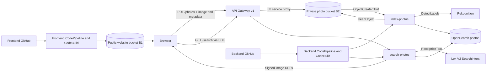

# Photo Album Search

A deployable implementation of Cloud Computing and Big Data Systems, Fall 2026, Assignment 3. Upload a JPEG or PNG, optionally add labels such as `Sam, Sally`, and search from the S3-hosted website by label or by a phrase such as “show me photos with cats and dogs in them.”



## Deploy the application

1. Install AWS CLI v2, Python 3.10 or newer, Bash, `zip`, and `unzip`. Configure an AWS CLI profile for an account allowed to create the resources below. The commands use `us-east-1` by default.

   ```sh
   export AWS_REGION=us-east-1
   export AWS_PROFILE=your-profile
   aws sts get-caller-identity
   ```

2. Confirm the deployment role can manage CloudFormation change sets, IAM roles and PassRole, Lambda functions and invocation permissions, S3 buckets and website policies, API Gateway REST APIs and API keys, Lex V2 bots/versions/aliases, and OpenSearch domains. Creating the first OpenSearch domain may require permission to create its service-linked role. The pipeline stack additionally requires CodePipeline, CodeBuild, CodeConnections, and CloudWatch Logs management. Reading the generated API key requires API Gateway management GET access to that key. If your course account lacks an action, use an authorized deployment profile or ask the account administrator to grant it. If they supply a CloudFormation service role that your profile is authorized to pass, set `CFN_EXECUTION_ROLE_ARN`. Your CLI profile still needs permission for direct commands such as SDK publication, API key retrieval, and smoke testing.

   The assignment requires a public S3 website. B1 permits public object reads through its bucket policy. Account or organization S3 public-access restrictions can override those bucket settings. Use an approved account where that policy is permitted. B2 and the pipeline artifact bucket block public access. The full deployment creates a billed single-node OpenSearch domain plus usage-based services.

3. From the project root, deploy and publish the frontend. The default stack name is `photo-album-a3`. The photo bucket defaults to a name derived from the AWS account and region. Set `PHOTO_BUCKET_NAME` before the first run if you need another globally unique name. The assignment fixes the OpenSearch domain to `photos` and the Lambda names to `index-photos` and `search-photos`, so run one instance per account and region.

   ```sh
   scripts/deploy-app.sh full
   ```

   Domain provisioning can take 20 minutes or more. The script generates the JavaScript SDK from stage `v1` and uploads it with the website. If publication fails after the stack succeeds, rerun the same command to retry the publishing step.

4. Open the printed `WebsiteUrl`. Retrieve the demo key and paste it into **Album API key** on the page.

   ```sh
   scripts/show-api-key.sh
   ```

   The key lives in the page only until refresh. Keep it out of Git, screenshots, and shared logs. API Gateway uses it for usage limits and demo access. The S3 website endpoint uses HTTP as required by S3 website hosting, and the browser sends API requests over HTTPS. Use demo images and a demo key on this assignment site.

### Deploy just the assignment’s T1 minimum

`infra/application.json` is the submission template. Its default `EnableSearch=false` provisions both named Lambda functions with real inline source, API Gateway, the private photo bucket, and a public website bucket with `WebsiteUrl` output. The full feature set also requires the Lex alias, OpenSearch domain, and S3 trigger, supplied by `EnableSearch=true`.

```sh
scripts/deploy-app.sh minimum
```

Choose either mode initially. Upgrade the same minimum stack with `scripts/deploy-app.sh full`. This keeps the same buckets and application names. When changing Lambda source for T1, run `python3 infra/generate.py` and deploy the updated template. CloudFormation sees the changed inline code. You can also update the standalone JSON’s `Code.ZipFile` values directly if submitting the JSON alone.

## Deploy the two GitHub pipelines

1. Push the project to GitHub. For separate frontend and backend repos, put the project at the root of both repos. Each pipeline only runs its own buildspec. One shared repo is also supported, with either a shared branch or independent branches.
2. In the same AWS region, open **Developer Tools → Settings → Connections**, create a GitHub connection, and complete the GitHub App authorization for both repos. Wait for status **Available**. Copy the connection ARN.
3. Deploy the pipeline stack after the app stack succeeds.

   ```sh
   export CONNECTION_ARN='arn:aws:codeconnections:us-east-1:ACCOUNT:connection/CONNECTION-ID'
   export BACKEND_REPO='your-org/photo-album-backend'
   export FRONTEND_REPO='your-org/photo-album-frontend'
   export BACKEND_BRANCH=main
   export FRONTEND_BRANCH=main
   scripts/deploy-pipelines.sh
   ```

4. In CodePipeline, confirm both initial builds succeeded. Push a distinct commit to each configured branch and verify that its commit ID appears in the source stage and that the build/deploy stage goes green. The backend build tests and packages both functions before updating their code and waits for each Lambda update. The frontend build checks JavaScript syntax and runs browser-code tests, fetches the generated SDK, and publishes the site. Pipeline builds update Lambda code directly. Use the same backend revision when regenerating T1. A later stack update that replaces the inline code deploys the code from that template revision.

## API and search behavior

| Route | Request | Success |
| --- | --- | --- |
| `PUT /v1/photos?key=demo.jpg` | `x-api-key`, image `Content-Type`, optional `x-amz-meta-customLabels`, and raw image bytes | `200 {}`; S3 has accepted the upload |
| `GET /v1/search?q=show%20me%20cats` | `x-api-key` and URL-encoded text | `200 {"results":[{"url":"…","labels":["Cat","Sam"]}]}` |
| `OPTIONS /v1/photos`, `OPTIONS /v1/search` | CORS preflight | `200` for the stack’s website origin, including the custom metadata header |

The route `/photos` follows the assignment PDF. The search response follows the linked [course Swagger schema](https://raw.githubusercontent.com/001000001/ai-photo-search-columbia-f2018/master/swagger.yaml). See `infra/generate.py` for the API definition embedded in the application template.

- Send JPEG or PNG bytes directly. The upload route passes the image to S3 and maps the custom header to S3 metadata. The generated SDK handles browser search. The browser uses Fetch for uploads to send bytes without JSON serialization. Use unique object keys. The browser generates one per upload.
- The indexer listens for S3 PUT events, decodes the object key, reads the event’s object version with HeadObject, and stores every label returned by DetectLabels along with trimmed custom labels. It deduplicates by normalized spelling and keeps display labels. Repeated notifications update the same document. Older notifications cannot overwrite a newer document for the same key. The assignment covers PUTs. Deleting photos or overwriting an image with invalid bytes does not remove the old index document automatically.
- Lex first tries two trained keyword slots. If they do not cover the query, LF2 elicits a free-form slot through the same bot alias, so names and Rekognition labels outside the training examples can still match. Search uses case-insensitive whole-label matching, normalizes whitespace, and checks common English singular/plural forms. Commas, “and,” and “or” combine labels as a union. For a label containing one of those separators, double quotes preserve the phrase as one search term. The application handles the supported search phrases and labels in the en-US bot locale. Browser-supplied metadata supports printable ASCII and commas delimit labels.
- Search follows all OpenSearch result pages within one request. A response that would exceed the API payload budget returns an explicit error. Empty text, no keywords, and zero matches return `{"results":[]}`. Search results contain 15-minute S3 signed URLs. Direct public access to B2 is blocked.
- CORS is scoped to the emitted S3 website origin. The API key is required for both application methods and omitted from preflight. The upload role can write only B2 objects. The Lambdas use IAM-signed OpenSearch access scoped to their index and search operations.

## Check the acceptance criteria

### Local checks

```sh
python3 -m pip install -r tests/requirements.txt
python3 infra/generate.py --check
python3 -m unittest discover -s tests -v
node --check frontend/app.js
node --test tests/frontend.test.js
```

Optional schema lint from a Python environment with `cfn-lint` installed:

```sh
cfn-lint -r us-east-1 -t infra/application.json infra/pipelines.json
```

### Live checks

1. Deploy the full stack. Use a recognizable JPEG or PNG, such as a cat or dog photo you can share, and run:

   ```sh
   python3 scripts/smoke.py /path/to/photo.jpg
   ```

   The script checks public website and SDK access, CORS preflight, API key enforcement, raw upload bytes, S3 metadata with and without custom labels, a direct S3 PUT, search by each custom label, group search, empty results, valid image retrieval, and independent search across every detected Rekognition label. It leaves three uniquely named objects for inspection.

2. In the browser, upload a photo with two custom labels. Search for both separately, then search for one as part of a natural-language sentence. Upload a second photo without custom labels and search for one automatic label. Use two photos with different labels to verify that a grouped search includes photos matching either part.
3. Check T1 outputs for `WebsiteUrl` and the two buckets, Lambda functions, and API. Check indexing logs for the PUT events:

   ```sh
   aws logs tail /aws/lambda/index-photos --since 15m
   aws logs tail /aws/lambda/search-photos --since 15m
   ```

4. Push to both GitHub branches and record the corresponding successful pipeline execution IDs. Compare the Lambda code’s last-modified time and the frontend object’s timestamp or content with the pushed revisions.

| Symptom | Where to check |
| --- | --- |
| Public bucket policy deployment fails | CloudFormation event and S3 account/organization public-access restrictions |
| Upload succeeds, photo is missing | B2 HeadObject metadata and version, LF1 logs, Rekognition permissions, OpenSearch authorization |
| Browser reports CORS or 403 | Exact `WebsiteUrl` origin, preflight headers, key and usage-plan association, then gateway logs |
| Search is down or returns no labels for known data | LF2 logs, Lex live alias and en-US build, OpenSearch availability, exact stored label spelling |
| GitHub pushes do not trigger builds | Connection status and granted repo access, source branch spelling, pipeline source action |

## Remove the deployment

Save any wanted images and evidence first. Empty the pipeline artifact bucket before deleting the pipeline stack. Empty the website and photo buckets before deleting the app stack. For the versioned photo bucket, remove **all object versions and delete markers**. Then delete the pipeline stack and app stack in CloudFormation, in that order, and wait for deletion to finish. Review any remaining Lambda CloudWatch log groups and the GitHub connection if they are no longer needed.

## Project layout

| Path | Contents |
| --- | --- |
| `backend/` | Lambda entry points and shared AWS/OpenSearch code |
| `frontend/` | Static website and SDK client integration |
| `infra/` | CloudFormation JSON templates and their generator |
| `scripts/` | One-command deployment, publishing, key retrieval, and live smoke test |
| `tests/` | Local checks for metadata, Lex behavior, result paging, and infrastructure contracts |
| `buildspec-*.yml` | Independent backend and frontend CodeBuild stages |
